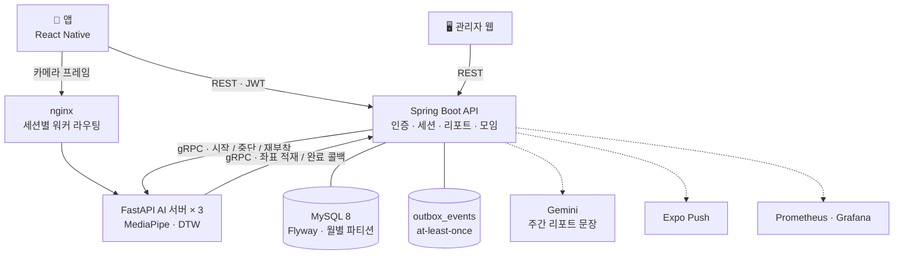

# ShadowFit

**카메라로 찍은 운동 자세를 기준 동작과 시계열로 비교해, 실시간으로 교정해 주는 홈트레이닝 앱.**

[](https://github.com/Shadowfit/init/actions/workflows/backend-test.yml)
[](https://github.com/Shadowfit/init/actions/workflows/ai-server-test.yml)
[](https://github.com/Shadowfit/init/actions/workflows/frontend-test.yml)

<!-- 데모 영상/GIF 는 실기기에서 한 번 끝까지 돌려 본 뒤 여기에 넣는다. -->

스마트폰 카메라 화면이 AI 서버로 가서 MediaPipe 로 관절 좌표가 되고, DTW 로 기준 동작과 비교해 **싱크로율**이 계산됩니다.
결과는 색·문구 피드백과 세션 리포트로 돌아옵니다. React Native 앱 · Spring Boot 백엔드 · FastAPI AI 서버가 gRPC 로 맞물려 돌아갑니다.

> **이 저장소가 다루는 범위** — 3인 팀 프로젝트의 통합 저장소입니다. **백엔드·DB 는 [@Khyojae](https://github.com/Khyojae)(팀장)**, AI 서버와 앱 화면은 팀원이 담당했습니다(역할 분담: [`docs/PRD.md`](./docs/PRD.md)).
> 아래 «측정한 것» 은 백엔드·DB 쪽 기록입니다.

---

## 무엇을 하는 앱인가

| 기능 | 설명 |
| :--- | :--- |
| **실시간 자세 분석** | 앱이 카메라 프레임을 보내면 AI 서버가 관절 좌표를 뽑고, 기준 동작과 DTW 로 비교해 반복(rep)마다 싱크로율을 계산합니다. 스쿼트는 횟수와 점수를, 런지는 횟수만 셉니다(점수는 아직 없음) |
| **기준 동작 관리** | 관리자가 기준 영상을 올리거나 3D 기준 포즈를 등록하고, 종목별 판정 기준(정석 / 위험)을 관리자 웹에서 조정합니다 |
| **세션 신뢰성** | 앱·AI 서버가 중간에 끊겨도 세션이 영구히 «진행 중» 으로 남지 않습니다 — 종료 통보 재전송(아웃박스), 이어하기, 타임아웃 스케줄러 |
| **리포트** | 세션별 취약 구간과 이전 세션 대비 변화, 주간 요약, 주간 AI 총평(Gemini — 출력 검증에 실패하면 템플릿 문장으로 대체) |
| **모임·알림** | 초대 코드 모임, 활동 피드, 재촉·응원, 푸시 알림 |
| **개인정보** | 약관·개인정보·건강정보(키·몸무게)를 분리해 동의 기록, 앱 안 회원 탈퇴 시 좌표·사진까지 삭제(실패하면 재시도) |
| **관리자 웹** | 종목·카테고리·기준 영상, 통계, 회원·세션 조회 (`admin-web/`) |

> 운동 종목은 스쿼트·런지·플랭크가 등록돼 있지만 **분석기가 있는 것은 스쿼트(횟수+점수)와 런지(횟수)** 입니다. 플랭크는 분석기가 없어 세션 생성이 막혀 있습니다.

---

## 아키텍처



- 앱은 **프레임을 AI 서버에 직접** 보내고(분석 지연을 줄이려고), 세션·기록·리포트는 Spring 이 맡습니다.
- AI → Spring 은 gRPC 콜백으로 **자세 좌표 배치**와 **완료 결과**를 적재합니다. 세션 종료 통보는 트랜잭션 아웃박스로 보내 유실되지 않게 했습니다.
- AI 서버는 GIL 병목을 피하려고 **3개 프로세스**로 나누고, 같은 세션의 프레임이 항상 같은 워커로 가도록 nginx 가 라우팅합니다.
- 결합 구조 상세: [`docs/architecture/`](./docs/architecture/README.md), 설계 결정 기록: [`docs/adr/`](./docs/adr/README.md)

---

## 백엔드·DB 에서 측정한 것

> 합성 데이터 1억 행 · **실제 사용자 트래픽 없음** · 로컬은 절대 성능치를 인용할 수 없고 **델타와 메커니즘만** 신뢰합니다.

`pose_data` 테이블을 1억 행까지 키워 놓고 스키마 변경·보존·백업·복제를 직접 해 본 기록입니다.

- **한 장 요약** — [`docs/portfolio/one-pager.md`](./docs/portfolio/one-pager.md) (수치마다 조건 표기)
- **스크립트** — [`loadtest/`](./loadtest/) · **결과** — [`loadtest/results/`](./loadtest/results/)

| 실험 | 핵심 수치 | 조건 | 기록 |
| :--- | :--- | :--- | :---: |
| 무중단 스키마 변경 | 쓰기 정지 **69초 → 0.36초** | EC2 · 1,000만 행 | [결과](./loadtest/results/online-ddl-aws-2026-08-12/README.md) |
| 보존 기간 삭제 | 삭제 **18.6분 → 1.8초** | 로컬 · 1억 행 | [결정](./docs/decisions/pose-data-partition-fk-tradeoff.md) |
| 백업·복구 | 복구 **21분**(논리) · **174초**(물리) | EC2 · 1억 행 | [결과](./loadtest/results/backup-restore-aws-2026-08-13/README.md) |
| 복제 | 지연 **약 60초** · 반동기 처리량 **−5.9%** | EC2 2대 · 1,000만 행 | [결과](./loadtest/results/replication-aws-2026-08-22/README.md) |
| 쓰기 처리량 | 초당 **267건 → 1,013건** | EC2 2대 · 36판 | [결과](./loadtest/results/session-spread-aws-2026-08-17/README.md) |
| 적재량 줄이기 | 초당 **222건 → 914건** | EC2 2대 · 8판 | [결과](./loadtest/results/session-spread-aws-2026-08-17/P2-downsample-multisession.md) |

**좋아진 것만 적지 않고 그 대가와 원인을 함께 남겼습니다.**

- **스키마 변경의 대가** — 작업 시간 1.64배, binlog 441MB 증가 ([결정 문서](./docs/decisions/online-ddl-vs-blocking-alter.md))
- **파티션의 대가** — 외래 키를 쓸 수 없어 회원 탈퇴 시 삭제를 별도 경로로 처리해야 했고, 지금은 아웃박스로 재시도합니다
- **복구 시간 정정** — 처음 잰 9초는 파일 시스템이 복사를 건너뛴 값이라 174초로 고쳐 적음 ([교정 기록](./loadtest/results/restore-reflink-2026-08-14/README.md))
- **쓰기 처리량의 원인** — 디스크가 아니라 행 락 대기였습니다. 락을 기다린 요청이 30,000건 중 29,999건에서 40건으로 줄었습니다
- **결론이 뒤집히면 뒤집힌 채로 남깁니다** — 쓰기 천장은 4차까지 재측정하며 결론이 세 번 바뀌었고 그 과정이 문서에 그대로 있습니다

### 코드에서 확인할 수 있는 신뢰성 설계

| 주제 | 내용 | 기록 |
| :--- | :--- | :---: |
| 세션 종료 통보 | 세션 변경과 통보를 **한 트랜잭션**에 저장하고 발행기가 전달 — 멱등 수신, 백오프 재시도, 한도 소진 시 FAILED + 지표 | [ADR-0001](./docs/adr/0001-use-transactional-outbox-for-session-end-notification.md) |
| 동시 갱신 | AI 완료 콜백과 타임아웃 스케줄러가 같은 세션을 경쟁 — 낙관적 락 + 재시도, 충돌을 지표로 집계 | [`failure-modes.md`](./docs/portfolio/failure-modes.md) |
| AI 호출 보호 | gRPC deadline + 워커별 서킷브레이커 | [ADR-0003](./docs/adr/0003-split-circuit-breaker-per-ai-worker.md) |
| 검출기 동시성 결함 | 검출기가 세션이 아니라 **스레드**에 붙어 세션이 섞이던 문제 — 검출률 **~30% → 95.6%** (4세션·3fps·개발 장비) | [`one-pager.md`](./docs/portfolio/one-pager.md) |
| 자원 상한 | 동시 세션 상한을 숫자로 박지 않고 `(컨테이너 메모리 − 기본 RSS) ÷ 검출기 1개 98.7MB` 로 **실측에서 유도** | [`one-pager.md`](./docs/portfolio/one-pager.md) |
| 보존·삭제 | 월별 파티션 자동 DROP, outbox 보존 정리(PK 범위 배치), 탈퇴 후 삭제 재시도 | [ADR-0006](./docs/adr/0006-partition-pose-data-with-fk-removal-and-async-deletion.md) |
| 인증 | access / refresh 토큰 종류 분리, refresh 회전과 재사용 탐지, 로그인 시도 제한 | [`docs/17-error-codes.md`](./docs/17-error-codes.md) |
| 관측성 | correlation id 전파 + 커스텀 지표(세션 전이, 낙관락 충돌, outbox 적체·실패, 스케줄러 tick) | [`monitoring/`](./monitoring/README.md) |

---

## 현재 상태와 한계

솔직하게 적습니다.

- **실사용자와 운영 환경이 없습니다.** 데이터는 합성이고, 운영 서버에 배포한 적이 없습니다(`docker-compose.prod.yml` 은 실호스트 검증 전). 「부하 테스트 기반 검증」이지 운영 경험이 아닙니다.
- **자세 판정의 정확도 검증이 얕습니다.** 실제 운동 영상 몇 개로 확인했고, 그중 한 영상은 5회 중 1회만 검출했습니다. 정확도를 말하려면 라벨된 영상 수십 개로 재야 합니다. (AI 서버 담당 영역)
- **개인정보 처리방침·약관은 초안**입니다([`docs/legal/`](./docs/legal/README.md)). 법률 검토 전이라 게시하지 않았고, 서버의 동의 강제(`consent.enforce`)도 꺼져 있습니다.
- **알려진 미완성** — 비밀번호 재설정, 공지·QnA, 서버 다중 인스턴스(세션 라우팅이 단일 서버 전제), TLS 와 도메인. 목록과 근거: [`docs/tasks/`](./docs/tasks/)

---

## 기술 스택

| 영역 | 사용 기술 |
| :--- | :--- |
| 앱 | React Native · Expo(expo-router) · TypeScript · zustand |
| 백엔드 | Spring Boot 3.5 · Java 21 · MySQL 8.0 · gRPC · Flyway · Micrometer |
| AI 서버 | FastAPI · MediaPipe · DTW(dtaidistance) · gRPC |
| 관리자 웹 | Vite · React · TypeScript |
| 인프라 | Docker Compose · nginx · GitHub Actions(CI·이미지 빌드) · Prometheus · Grafana |

---

## 실행하기

```bash
git clone https://github.com/Shadowfit/init.git
cd init
cp .env.example .env   # JWT_SECRET · INTERNAL_API_TOKEN · AI_PUBLIC_TOKEN 등을 직접 생성해 채우기
docker compose up -d   # mysql + backend + ai-server
```

앱은 별도로 실행합니다. `frontend/.env` 의 `EXPO_PUBLIC_AI_PUBLIC_TOKEN` 은 루트 `.env` 의 `AI_PUBLIC_TOKEN` 과 **같은 값**이어야 운동 분석이 시작됩니다([`frontend/.env.example`](./frontend/.env.example)).

```bash
cd frontend
npm ci
npx expo start
```

전체 순서(사전 설치 포함)는 [`docs/14-how-to-run.md`](./docs/14-how-to-run.md) 에 있습니다.

<details>
<summary>파트별로 따로 실행하기</summary>

```bash
# Backend — dev 프로파일이 Swagger·SQL 로그를 켠다 (프로파일 없이 띄우면 안전 기본: 문서·SQL 로그 꺼짐)
cd backend && ./gradlew bootRun --args='--spring.profiles.active=dev'
#   Swagger: http://localhost:8080/swagger-ui (dev 프로파일에서만)

# AI Server
cd ai-server && pip install -r requirements.txt && uvicorn app.main:app --reload

# 관리자 웹
cd admin-web && npm ci && npm run dev
```

관측 스택(Prometheus·Grafana)은 측정 오염을 막으려고 기본 구동에서 빠져 있고, `docker compose --profile obs up -d` 로 켭니다.
</details>

---

## 테스트와 CI

```bash
./gradlew :backend:test            # 백엔드 — H2 기본, Docker 가 있으면 실 MySQL(Testcontainers) 테스트도
cd ai-server && pytest tests       # AI 서버
cd frontend && npx tsc --noEmit    # 앱 타입 체크
```

- 백엔드는 통합·동시성(레이스) 테스트를 포함해 **1,000개 이상**, AI 서버는 **300개 이상**입니다(2026-11 기준).
- PR 마다 위 세 가지가 GitHub Actions 로 돕니다. `main` 에 머지되면 이미지가 GHCR 로 빌드·푸시되지만 **배포는 자동화돼 있지 않습니다**([`docs/19-deployment.md`](./docs/19-deployment.md)).
- 테스트 가이드: [`docs/18-testing-guide.md`](./docs/18-testing-guide.md)

---

## 폴더 구조

| 폴더 | 내용 |
| :--- | :--- |
| `frontend/` | React Native(Expo) 앱 |
| `backend/` | Spring Boot API 서버 |
| `ai-server/` | FastAPI 자세 분석 서버 |
| `admin-web/` | 관리자 웹 |
| `proto/` | gRPC 스키마(`exercise.proto`) — 수정하면 양쪽 생성 코드를 함께 갱신 |
| `mysql/` | 초기 스키마·시드 (운영 스키마 이력은 `backend/.../db/migration` 의 Flyway) |
| `nginx-ai/` | AI 워커 세션 라우팅 |
| `monitoring/` | Prometheus·Grafana 설정과 대시보드 |
| `loadtest/` | 부하·실험 스크립트와 **결과 기록** |
| `docs/` | 설계·결정·운영 문서 |

---

## 더 읽을 문서

| 문서 | 내용 |
| :--- | :--- |
| [`docs/portfolio/one-pager.md`](./docs/portfolio/one-pager.md) | 측정 결과 한 장 요약(수치마다 조건) |
| [`docs/portfolio/failure-modes.md`](./docs/portfolio/failure-modes.md) | 컴포넌트별 «어떻게 깨지고 얼마나 번지나» 목록 |
| [`docs/adr/`](./docs/adr/README.md) · [`docs/decisions/`](./docs/decisions/) | 설계 결정 기록 |
| [`docs/PRD.md`](./docs/PRD.md) | 제품 요구사항 |
| [`docs/07-api-design.md`](./docs/07-api-design.md) · [`docs/05-database-design.md`](./docs/05-database-design.md) | API·DB 설계 |
| [`docs/17-error-codes.md`](./docs/17-error-codes.md) | 에러 코드 |
| [`docs/13-docker-setup.md`](./docs/13-docker-setup.md) · [`docs/19-deployment.md`](./docs/19-deployment.md) | Docker 구성 · 배포 |
