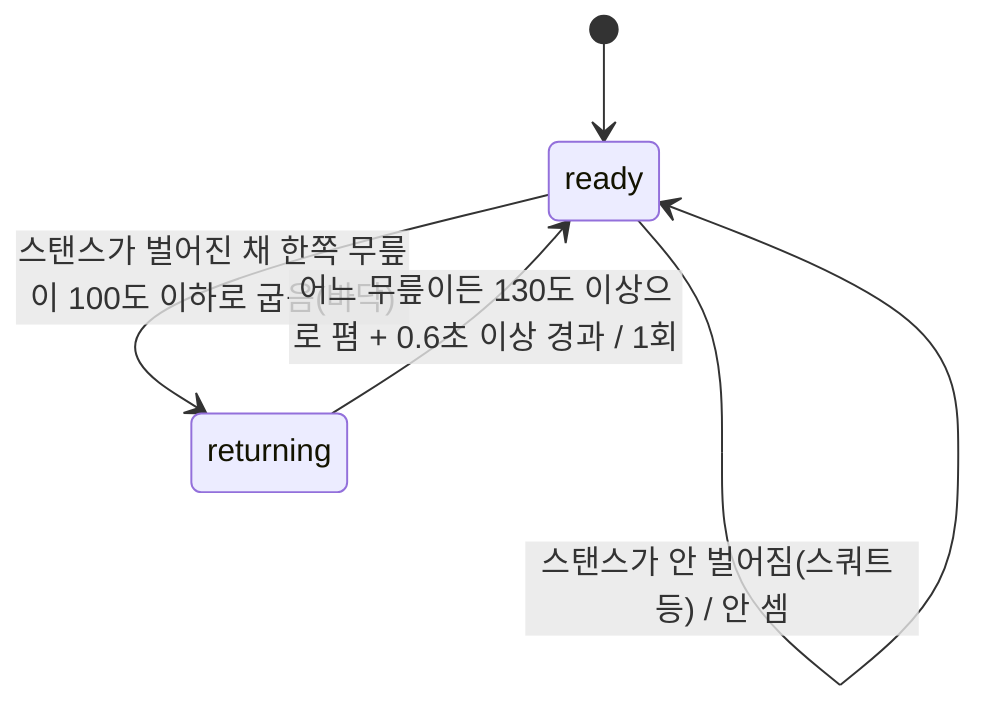

# 전방 런지 반복 횟수 측정

작성: 2026-09-17. 사용자 요청에 따라 전방 런지를 구현했다.
2026-09-22 재설계: 아래 "2026-09-22 재설계" 절 참고 — 판정 축 자체를 발 이동 거리에서
무릎 각도 사이클로 바꿨고, 지원 범위를 **완전 측면 촬영**으로 좁혔다.

범위는 **완전 측면에서 촬영한 런지의 횟수**다. 학습 모델 신규 훈련, 자세 점수,
부상 위험 판정은 포함하지 않는다. 전방/후방/워킹 런지는 총 횟수 판정에서는 더 이상
구분하지 않지만(아래 참고), **좌우(왼발/오른발) 구분은 완전 측면 촬영에서만 신뢰할 수
있다.**

## 1. 참고 근거와 적용 범위

| 근거 | 적용한 내용 | 그대로 재현하지 않은 부분 |
|---|---|---|
| Sousa et al., *A Movement Description Language for Functional Training Exercise Analysis*, JFMK 11(2):162, 2026, [DOI](https://doi.org/10.3390/jfmk11020162), §2 운동별 상태 설명·Figure 3 | 무릎 100° 이하를 바닥 경계로 사용 | 논문의 MDL 파서나 전체 시스템을 구현한 것은 아니다. 각도는 영상 기반 대리 지표이며 조절 가능한 기본값이다. |
| [MediaPipe Pose Classification — Repetition Counting](https://chuoling.github.io/mediapipe/solutions/pose_classification.html#repetition-counting) | 진입·복귀 경계를 다르게 두고 평활화를 사용해 경계 부근 중복 카운트를 줄이는 원칙 | kNN 자세 분류기의 확률을 사용하지 않는다. 좌표에서 계산한 무릎 각도에 시간 기반 EMA를 적용한다. |
| Hsu et al., *Viewpoint-invariant exercise repetition counting*, [DOI](https://doi.org/10.1007/s13755-023-00258-3) | 촬영 방향을 달리하고 수동 정답과 횟수를 비교하는 평가의 필요성 | 논문의 주기·스펙트럼 기반 알고리즘이나 시점 불변성을 구현·보장하지 않는다 — 오히려 2026-09-22 검증으로 시점 불변이 아니라는 것을 확인하고 완전 측면으로 범위를 좁혔다. |

논문에 보고된 정확도는 ShadowFit의 정확도가 아니다. 2026-09-22 이전에는 합성 좌표와
서비스 계약 테스트로만 검증했고, 실제 사람의 촬영본 정확도는 측정하지 않았다. 아래
"2026-09-22 재설계" 절이 그 실촬영 검증과 그 결과로 바뀐 설계를 기록한다.

## 2. 무엇을 1회로 세는가 (2026-09-22 이후)

1. 두 발이 앞뒤로 벌어진 스탠스(런지 자세)가 보이면, 별도의 "준비 자세 확인" 없이
   바로 인식한다 — 스트림이 이미 런지 바닥 자세로 시작해도 그 뒤로 다시 펴는 동작을
   1회로 센다.
2. 두 무릎 중 더 굽은 쪽이 100° 이하까지 굽혀지면 "바닥"이다.
3. 그 뒤 두 무릎 중 어느 쪽이든 130° 이상으로 다시 펴지면(완전히 편 160°까지는
   요구하지 않는다) 1회로 확정한다.
4. 어느 다리로 기록할지(왼발/오른발)는 **바닥 판정과 분리된 별도 신호**(발목-골반중심
   거리)로 정한다 — 완전 측면 촬영에서만 신뢰할 수 있다(§3·§6 참고).



가림·영상 끊김·저가시성이면 진행 중 판정을 버리고 다시 준비한다. 일시 중단 뒤
미완성 동작을 이어서 세어 가짜 1회를 만들지 않기 위해서다.

### 2026-09-17 초판과 달라진 점

초판은 "두 발 모으고 서 있다가 한쪽 발이 정해진 거리(어깨-골반 길이의 0.65배)만큼
앞으로 이동"하는 것으로 1회를 판정했다(발 이동 거리 기준, `forward_step` 임계값).
아래 2026-09-22 검증에서 이 전제 자체가 실촬영과 안 맞는 것으로 드러나 두 단계에
걸쳐 재설계했다.

## 3. 2026-09-22 재설계 — 실촬영 검증과 그 결과

### 3-1. 1차 검증: 발 이동 거리 판정이 실촬영에서 전부 0회

사용자가 실제 촬영한 4개 영상(`samples/validation/lunge_normal_01.mp4`·
`lunge_sallow_01.mp4`·`lunge_walking_01.mp4`·`lunge_45degree_01.mp4`)을 초판
코드로 재생한 결과, **calibration(두 발 모으고 서 있기) 단계조차 통과한 프레임이
0개**였다. 원인은 두 가지가 겹쳤다:

- `initial_stance`(두 발 간격 허용치)가 실제 준비 자세(어깨너비 정도)보다 훨씬
  빡빡했다 — 실측 발 간격이 허용치의 1.5~2.5배였다.
- calibration의 발 기준점(anchor) 흔들림 판정이 유예 없이 즉시 리셋됐다 — 사람이
  가만히 서 있어도 체중을 살짝 옮기거나 발끝 방향이 한 프레임 흔들리면 0.4초짜리
  안정 확인이 바로 처음부터 다시 시작됐다.

먼저 이 두 문제(스쿼트의 `ankle_outlier_grace_sec`와 같은 유예 장치 추가, 발 간격
허용치를 0.75로 완화)만 고쳤지만, calibration을 통과해도 **반복 판정 자체가 여전히
0회**였다. 무릎 각도·발목 이동 거리를 직접 추적해보니, 4개 영상 전부 "이미 벌어진
스탠스에서 제자리로 무릎만 굽혔다 폈다" 하는 동작이었다 — 발이 거의 안 움직여
`forward_step`(0.65) 문턱을 넘지 못했다. 즉 **발 이동 거리로 1회를 정의하는 것
자체가 실제 촬영된 동작과 안 맞았다.**

### 3-2. 판정 축 변경: 무릎 각도 사이클 (스쿼트와 같은 방식)

사용자 확인 후, 발 이동 거리 대신 스쿼트(`squat_counter.py`)와 같은 **무릎 각도
사이클**로 바꿨다. 스탠스가 벌어져 있고(두 발목 거리/몸통길이 ≥ 0.55) 한쪽 무릎이
100° 이하까지 굽혀졌다 펴지면 1회다. 스쿼트(양발 나란히)와는 이 스탠스 벌어짐
정도로만 구분한다.

트레이드오프: 발 이동 **방향**을 더 이상 추적하지 않으므로 전방/후방/워킹 런지를
구분하지 못한다 — 사용자가 명시적으로 "워킹 런지까지 다 세자"를 선택해 받아들인
트레이드오프다.

### 3-3. calibration 단계 제거

무릎 각도 사이클로 바꾼 뒤에도 여전히 심하게 과소 카운트됐다. 원인: "완전히 편
자세(160°)로 서야 다음 반복을 받을 준비가 된다"는 calibration 전제가, 실촬영에서
반복 사이 최고점이 130~170°로 들쭉날쭉하고 자주 160°를 못 넘는 바람에 **여러 반복을
하나로 뭉개버렸다** — `lunge_normal_01`에서 8초 동안 이어진 펄스 4~5개가 1회로
합쳐진 사례를 확인했다.

사용자가 "런지가 보이면 바로 세자"를 선택해, calibration(준비 자세 대기) 단계를
아예 없앴다. 스트림이 이미 런지 바닥 자세로 시작해도 그 뒤로 다시 펴면 1회로 센다.
"바닥→다시 폄" 판정 기준도 완전한 직립(160°) 대신 `recovered_angle`(130°)로 낮췄다
— 반복 사이 최고점이 130° 밑으로는 거의 안 내려간다는 실촬영 관찰에 근거한 구현값
이다.

### 3-4. 표본 간격보다 짧은 확인창 — 스쿼트에서 이미 겪은 버그가 그대로 있었다

calibration을 없앤 뒤 재검증하니 `lunge_sallow_01`이 여전히 0회였다. 원인은
`squat_counter.py`의 standing-confirm 버그와 정확히 같은 종류였다: 바닥 확인창
(`bottom_confirm_sec`=0.12초)이 3fps 표본 간격(≈0.33초)보다 짧은데, "표본 2개로
확인"을 요구해서 **표본 1개짜리 진짜 바닥 접촉이 매번 다음 표본에서 리셋**됐다.
스쿼트와 같은 보정(표본 간격이 이미 확인창보다 크면 그 표본 하나가 최대 해상도의
증거로 충분하다)을 바닥 확인·회복 확인 양쪽에 적용했다.

### 3-5. 바닥 검출과 좌우 라벨을 분리

`lunge_walking_01`(왼발·오른발을 번갈아 진행)에서, "발목이 골반 중심에서 더 멀리
떨어진 다리"를 곧바로 "바닥 판정에 쓸 다리"로 묶었더니 일부 프레임에서 실제로 더
깊이 굽은 반대쪽 다리를 놓쳤다 — 몸 전체가 전진하는 워킹 런지 특성상 뒷다리가 아직
이전 자세에서 덜 펴진 채로 남아 있는 순간이 있었다. **"바닥에 닿았는가"는 두 무릎 중
더 굽은 쪽으로 판단**하고, **좌우 라벨은 별도로** 발목-골반중심 거리로 정하도록
분리했다.

### 3-6. 좌우 라벨은 완전 측면에서만 신뢰할 수 있다 → 지원 범위를 좁힘

3-5의 분리 이후 4개 영상 전부 총 횟수는 합리적인 수준이 됐다(아래 §3-7 표). 그런데
`lunge_45degree_01`(45도 각도로 촬영)만 좌우 라벨이 크게 틀렸다 — 총 10회 중 9회를
"왼쪽"으로 잘못 붙였는데, 실제로는 후반 5회가 전부 오른쪽 다리 동작이었다(무릎 각도로
직접 확인). 완전 측면 3개(정상·얕음·워킹)는 좌우 라벨이 실제와 맞았다.

원인은 발목-골반중심 거리 신호 자체다 — 완전 측면(90°)에서는 "발목이 골반 중심에서
더 멀리 떨어진 쪽"이 곧 "앞다리"이지만, 45도처럼 비스듬한 각도에서는 원근 때문에 이
매핑이 깨진다. 이 신호를 45도에서도 통하게 보정하는 대신, **사용자 확인 후 런지의
지원 카메라 각도를 완전 측면으로 한정**했다 — 45도·정면 등 비스듬한 촬영은 지원
범위 밖이며, 총 횟수가 맞더라도 좌우 구분은 보장하지 않는다. 촬영 가이드(§7)에도
반영했다.

### 3-7. 최종 검증 결과 (2026-09-22)

`ai-server/scripts/evaluate_lunge.py`로 3fps에서 재생한 결과:

| 영상 | 촬영 각도 | 총 횟수 | 좌/우 | 비고 |
|---|---|---:|---|---|
| `lunge_normal_01.mp4` | 완전 측면 | 10 | 5/5 | |
| `lunge_sallow_01.mp4` | 완전 측면 | 5 | 2/3 | "얕은 런지"라는 파일명과 달리 실제로는 바닥(100°) 문턱을 여러 차례 넘었다 — 사람이 직접 센 정답과 아직 대조하지 않음 |
| `lunge_walking_01.mp4` | 완전 측면 | 10 | 5/5 | 왼발·오른발을 번갈아 진행했다는 촬영자 설명과 좌/우 분포가 일치 |
| `lunge_45degree_01.mp4` | 45도 | 10 | 9/1 (틀림, 실제로는 약 5/5 추정) | §3-6에 따라 **지원 범위 밖** — 총 횟수 참고용, 좌우는 신뢰 불가 |

⚠️ **위 총 횟수도 사람이 프레임 단위로 정밀하게 센 정답과 대조된 것은 아직 아니다** —
스쿼트 2026-09-21 검증(`docs/verification/`)과 같은 수준의 사람 판정 대조가 필요하다.
현재 결과는 "알고리즘이 합리적으로 작동하기 시작했다"는 근거이지 "실사용 정확도"의
근거가 아니다.

자동 테스트(`tests/test_lunge_analyzer.py`·`test_lunge_integration.py`)는 이번
재설계에 맞춰 전부 갱신했다. 특히 예전에는 "세면 안 됨"으로 잠가뒀던 워킹·후방
런지 스타일(발이 원위치로 안 돌아옴)은 이제 "세야 함"으로 기대치를 바꿨다
(`test_stance_based_cycles_now_count`) — 3-2의 트레이드오프를 그대로 테스트로
고정한 것이다.

## 4. 좌표·설정

`ai-server/app/core/lunge_analyzer.py`의 `LungeThresholds`가 설정의 출처다.
좌표는 `(x × 영상 너비/높이, y)`로 변환해 세로·가로 영상에서 같은 이미지 평면 각도를
얻는다. MediaPipe 정규화 `z`는 섞지 않는다. 스탠스 벌어짐(`stagger_min`)은 두 발목
사이 거리를 준비 자세의 어깨 중심↔골반 중심 거리로 나눠 정규화한다.

| 설정 | 기본값 | 근거 |
|---|---:|---|
| 바닥 | 100° | MDL 논문 초기값 채택 |
| 다시 폄(회복) | 130° | 2026-09-22 실촬영 관찰(반복 사이 최고점이 대체로 130° 이상) — 논문 검증치 아님 |
| 가시성 | 모든 필수 관절 0.6 이상 | 구현 기본값 |
| 바닥 확인 | 0.12초 | 구현 기본값. 표본 간격이 이 값보다 크면 표본 1개로 대체(§3-4) |
| 회복 확인 | 0.12초 | 위와 동일 |
| 최소 동작 시간 | 0.6초 | 구현 기본값 |
| 영상 공백 | 1.2초 초과 시 초기화 | 구현 기본값 |
| EMA 시간 상수 | 0.06초 | 구현 기본값 |
| 스탠스 벌어짐(런지 vs 스쿼트 구분) | 0.55(몸통 길이 배수) | 2026-09-22 실촬영 4개: 무릎이 굽혀진 순간 비율 0.74~1.70, 가만히 선 자세는 0~0.45. 스쿼트 실촬영으로는 아직 재검증 안 함(§3-6 유사 위험 — 발이 나란해도 몸통이 기울면 이 비율이 올라갈 수 있음) |

각도 외 수치는 논문에서 검증된 값으로 주장하지 않는다. 프레임 개수가 아닌 서버의
단조 증가 시계로 시간을 잰다. 라이브 경로의 기존 300ms 유입 제한은 유지한다.

## 5. 서비스 연결

- AI 등록: `exercise_id=2 → lunge`. 플랭크 등 미지원 운동은 계속 거절한다.
- `StartAnalysis`, `ReattachAnalysis`: 런지는 기준 자세 좌표가 없어도 시작·복구한다.
- `/pose`: 총 횟수에 더해 `lunge`에 `phase`, `lead_leg`, `left_reps`, `right_reps`,
  `unassigned_reps`, `guidance`, `score_available=false`를 반환한다. `sync_rate=null`.
  `phase`는 `"ready"`/`"returning"`만 실제로 나온다 — `"calibrating"`/`"descending"`은
  스키마 호환을 위해 남아 있는 미사용 값이다(2026-09-22, §3-3).
- 총 횟수는 기존 rep 배치·완료 콜백으로 저장된다. 인증 nonce·워커 라우팅·세션 잠금은 유지한다.
- 런지에는 스쿼트의 BACK_BENT 피드백을 적용하지 않는다.
- protobuf 숫자 필드는 그대로 둔다. 런지 콜백의 `sync_rate=0`은 전송 형식상 기본값이다.
  Spring은 `exercises.repetition_only=true` 종목에 대해 **DB에 NULL로 저장**하고 세션
  점수 통계도 NULL로 둔다. SSE 점수는 nullable, 상세 리포트에는 `scoreAvailable`을 추가했다.
- Flyway V22는 점수 NULL 허용, `repetition_only` 열 추가, 런지 분석 활성화를 수행한다.
- 앱: 스쿼트/전방 런지 선택, 촬영·단계 안내, 좌우 카운터, 종료 요약을 제공한다.
  런지는 기존 예시 데이터 리포트 화면으로 보내지 않는다. 카메라 실패 시 가짜 이미지를 전송하지 않는다.

**좌우 기록의 현재 한계:** 총 횟수는 DB에서 복원하지만 좌우 분류는 AI 세션 메모리에만 있다.
동일 워커의 살아 있는 세션에 재부착하면 유지된다. AI 프로세스가 재시작되면 기존 총 횟수를
`unassigned_reps`로 표시하고 새 동작부터 좌우를 구분한다. 기존 총 횟수를 임의로 반씩 나누지 않는다.
**추가로(2026-09-22) 좌우 분류 자체가 완전 측면 촬영에서만 신뢰할 수 있다(§3-6) — 45도 등
비스듬한 각도에서는 총 횟수는 맞아도 좌우가 뒤섞일 수 있다.**

## 6. 실행 및 확인

배포 순서: **새 AI → 새 백엔드(V22 적용·재시작) → 새 프런트**.
구 AI가 남아 있는 동안 런지 시작을 활성화하지 않는다. 로컬 변경만으로 운영 DB에 적용되지는 않는다.
실행에는 기존 백엔드·AI 연결과 `EXPO_PUBLIC_AI_PUBLIC_TOKEN` 등 정상 설정이 필요하다.

```powershell
# ai-server 디렉터리, 의존성이 설치된 Python 환경
$env:DEBUG='false'
python -m pytest tests --ignore=tests/test_camera.py -p no:cacheprovider -q
python scripts/evaluate_lunge.py ./clips/forward-lunge.mp4 --expected-left 5 --expected-right 5 --trace ./lunge-trace.csv
```

평가 스크립트는 로컬 고정 FPS 영상을 3fps로 분석하며 총/좌/우 횟수 오차와 설정을 출력한다.
`--sample-fps`로 다른 처리 속도도 비교할 수 있다. 프레임 누락·추론 실패는 CSV에서 확인한다.
동일 분석기를 사용하지만, 카메라 촬영·전송 지연까지 재현하는 통합 성능 측정은 아니다.

## 7. 촬영 가이드 (2026-09-22)

**완전 측면(90°)에서만 촬영한다.** 45도 등 비스듬한 각도는 총 횟수는 맞을 수 있어도
좌우 구분을 보장하지 않는다(§3-6) — 지원 범위 밖으로 취급한다.

- 카메라를 사람의 진행 방향과 직각(완전 측면)으로 고정한다. 정면·45도는 사용하지 않는다.
- 전신, 특히 양쪽 무릎·발목·발끝이 화면 안에 들어오게 한다.
- 두 발이 앞뒤로 벌어진 자세(런지)가 보이면 바로 인식하므로, 특별한 준비 자세 없이
  바로 동작을 시작해도 된다.
- 무릎을 완전히 펴지 않고 반복(펄싱)해도 되지만, 반복 사이에 어느 정도(130° 이상)는
  다시 펴야 한다 — 계속 깊이 굽힌 채로만 있으면 하나의 긴 동작으로 묶일 수 있다.
- 워킹 런지(발이 원위치로 안 돌아오고 계속 전진)도 이제 세어진다. 다만 좌우 구분은
  완전 측면 촬영에서만 신뢰할 수 있다.

실제 평가에서는 여러 사람의 좌/우 각 5~10회 촬영본을 확보하고 정상·얕은 동작·워킹·
가림·화면 이탈을 별도로 기록한다. 클립별 수동 총/좌/우 횟수와 비교해 절대 오차(MAE),
정확히 일치한 클립 비율, 좌우 라벨 정확도를 따로 보고한다 — §3-7이 그 대조를 아직
하지 않은 1차 결과다.

### 개발 환경 확인 (2026-09-22)

- AI: 206 tests + 61 subtests 통과 (`test_camera.py` 제외).
- 실촬영 4개(완전 측면 3개 + 45도 1개) 재생 결과는 §3-7 참고.
- 백엔드·프런트·전체 통합 실행은 2026-09-17 이후 재검증하지 않았다 — 이번 재설계는
  AI 판정 로직에 한정된다.
